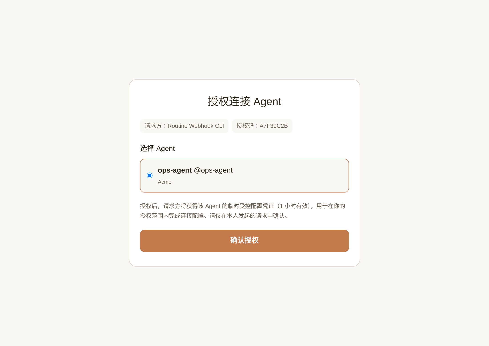
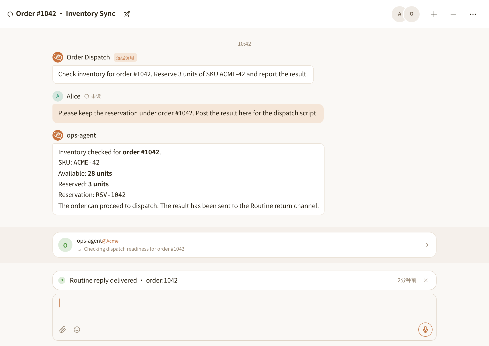

# @nia-teams/routine-webhook

Invoke Nia Teams cloud Agents from scripts, backend services, or local coding assistants: create or continue GroupChats by `topicKey`, and receive signed replies over WebSocket or HTTPS callbacks.

```sh
npm install @nia-teams/routine-webhook
npx @nia-teams/routine-webhook init --name 'Order Dispatch' --task 'Check inventory, reply in chat, and return the result via reply_to_source.' --require-reply-approval
```

AI assistants: load [`./skills/routine-webhook/SKILL.md`](./skills/routine-webhook/SKILL.md), or `node_modules/@nia-teams/routine-webhook/skills/routine-webhook/SKILL.md` after installation.

[Chinese](./README_CN.md) · [Specification](./docs/SPECIFICATION.md) · [Maintainer context](./AGENTS.md)

## What It Does and Boundaries

- **`init`**: Browser approval creates a sole-follower Webhook Routine (`followers = [yourself]`) on a native Agent where you are `owner` or `admin`. Mac connection is on by default (`connectMac: true`): newly created chats connect your paired Mac. Pass `--no-connect-mac` to disable. Only Routine credentials are stored locally, never account login credentials.
- **One `topicKey` = one GroupChat**: A new key creates a chat (`--title` optional); reuse it for follow-ups. Credentials only access that Routine's chats, not other existing chats.
- **Replies require approval by default**: Only `reply_to_source` sends external replies, not regular chat messages. `--require-reply-approval` requires a TaskBar confirmation; `--auto-approve-reply` opts into unattended replies (`owner` / `admin` only).
- **External data never grants local authority**: Incoming payloads and replies are untrusted data and do not authorize local tool execution or credential changes.

## CLI Usage

Requires Node.js 20+; no local model or AI client is needed.

Run `init` above, open the printed URL, select your cloud Agent, and confirm authorization.



```sh
# New topicKey creates a GroupChat; the same topicKey continues that GroupChat
npx @nia-teams/routine-webhook send --topic-key order:1042 --title 'Order #1042 · Inventory Sync' --message 'Check inventory and reserve 3 units of SKU ACME-42.'

# Exit after receiving one matching reply
npx @nia-teams/routine-webhook listen --topic-key order:1042 --once
```

`listen` runs until stopped by default. Use `--timeout-ms MS` to set a deadline. Without that flag, `--once` waits up to 10 minutes for a matching reply.

One-way dispatch: add `--return none` to `send`, or pass `return: { type: 'none' }` to SDK `client.send(...)`. No `listen` or callback is needed; the cloud Agent works in GroupChat without sending external `routine.reply` events.



Manage channels (`--help` lists all flags):

```sh
npx @nia-teams/routine-webhook profiles        # List saved channels (secrets redacted)
npx @nia-teams/routine-webhook rotate-secret   # Re-authorize in browser and rotate secret
npx @nia-teams/routine-webhook delete          # Delete remote Routine and local profile
```

For disk-free CI or containers, set `NIA_ROUTINE_ID` and `NIA_ROUTINE_WEBHOOK_SECRET` (plus optional `NIA_TEAMS_URL`) to run `send` and `listen`.

## Programmatic SDK

Send a task ([`examples/send.ts`](./examples/send.ts), `npx tsx examples/send.ts`):

```ts
import { RoutineWebhookClient } from '@nia-teams/routine-webhook';

const client = await RoutineWebhookClient.fromProfile();
const result = await client.send({
  topicKey: 'order:1042',
  title: 'Order #1042 · Inventory Sync',
  message: 'Check inventory and reserve 3 units of SKU ACME-42.',
  payload: { orderId: '1042', sku: 'ACME-42', quantity: 3 },
  contextKeys: ['orderId'],
});
console.log(result);
```

Listen for replies ([`examples/listen.ts`](./examples/listen.ts), `npx tsx examples/listen.ts`):

```ts
import { RoutineWebhookClient, CredentialStore } from '@nia-teams/routine-webhook';

const store = new CredentialStore();
const profile = await store.get();
const client = new RoutineWebhookClient(profile);
const stream = client.listen({
  initialCursor: profile.cursor,
  onReply: async reply => { console.log(reply); },
  persistCursor: cursor => store.setCursor(cursor),
  onCursorExpired: async earliestCursor => {
    throw new Error(`Reply history expired at ${earliestCursor}; reconcile before resuming.`);
  },
  onError: error => { console.error(error.message); },
});
process.once('SIGINT', () => stream.stop());
await stream.run();
```

- Disk-free client: `new RoutineWebhookClient({ serverUrl, routineId, webhookSecret })`, or pass `getBearerToken` for Workload OIDC (see [`examples/oidc.ts`](./examples/oidc.ts)).
- HTTPS callback verification: `verifyRoutineCallback({ rawBody, signatureHeader, secret })` (see [`examples/verify-callback.ts`](./examples/verify-callback.ts)).
- Non-Node runtimes: call the HTTPS and HMAC wire protocol in [`docs/SPECIFICATION.md`](./docs/SPECIFICATION.md).

## Local MCP

The cloud Agent can call tools from MCP servers mounted on your Routine listener. Only server names and optional instructions go in the invocation; executable paths, URLs, and credentials stay on the listener. The MCP connection uses the Routine secret and is independent of the `source.return` mode.

### CLI

Provide an `mcp.json` for servers you already run or maintain. For example, with a local `inventory-mcp.mjs` MCP server and a separate Streamable HTTP endpoint:

```json
{
  "mcpServers": {
    "inventory": {
      "command": "node",
      "args": ["./inventory-mcp.mjs"],
      "instructions": "Read the local inventory count."
    },
    "lookup": { "type": "http", "url": "http://127.0.0.1:3001/mcp" }
  }
}
```

Run `listen` first. When it prints `Local MCP listener ready.`, run `send` in another terminal with the same Routine and `--client-id`:

```sh
npx @nia-teams/routine-webhook listen --client-id inventory-workstation --mcp-config ./mcp.json
npx @nia-teams/routine-webhook send --client-id inventory-workstation --mcp-config ./mcp.json \
  --topic-key order:1042 --message 'Read local stock using the inventory MCP server.'
```

Instead of a config file, repeat `--mcp NAME=COMMAND` for executables without arguments and `--mcp-url NAME=URL` for Streamable HTTP. Configure stdio `args`, `cwd`, `env` or HTTP `headers` in the file. `--topic-key` on `listen` filters reply output, not MCP routing. Use Ctrl+C or SIGTERM to stop the listener and its stdio children.

### TypeScript

After provisioning a Routine, install `@modelcontextprotocol/sdk` for the in-process example. Run `npx tsx examples/local-mcp.ts` for the resolver or `npx tsx examples/local-mcp.ts --static` for a static mount ([source](./examples/local-mcp.ts)).

```ts
import { McpServer } from '@modelcontextprotocol/sdk/server/mcp.js';
import { RoutineWebhookClient } from '@nia-teams/routine-webhook';

const topicKey = 'order:1042';
function inventory(stock: number) {
  const server = new McpServer({ name: 'inventory', version: '1.0.0' });
  server.registerTool('get_stock', { description: 'Read the stock count' }, async () => ({
    content: [{ type: 'text', text: String(stock) }],
  }));
  return server;
}

const useStaticMount = process.argv.includes('--static');
const client = await RoutineWebhookClient.fromProfile(useStaticMount ? {
  mcpServers: { inventory: inventory(3) },
} : {
  resolveMcp: ({ topicKey, serverName }) => {
    if (serverName !== 'inventory') return;
    if (topicKey === 'order:1042') return inventory(3);
    if (topicKey === 'order:1043') return inventory(7);
  },
});

let ready!: () => void;
const authenticated = new Promise<void>(resolve => { ready = resolve; });
const stream = client.listen({ onReady: ready, onReply: reply => { console.log(reply.content); } });
const running = stream.run();
process.once('SIGINT', () => stream.stop());
process.once('SIGTERM', () => stream.stop());
try {
  const connected = await Promise.race([authenticated.then(() => true), running.then(() => false)]);
  if (connected) {
    await client.send({
      topicKey,
      message: 'Use the inventory MCP server to read local stock and reply with the count.',
      mcpServers: useStaticMount ? undefined : [{ name: 'inventory' }],
    });
    await running;
  }
} finally {
  await client.close();
}
```

A static map accepts `McpServer`, `Server`, compatible `Transport`, stdio settings (`command`, optional `args`, `env`, `cwd`, `instructions`), and Streamable HTTP settings (`type: 'http'`, `url`, optional `headers`, `instructions`). The SDK does not require the MCP SDK at runtime.

`send()` uses the static declarations by default; `mcpServers: [{ name, instructions? }]` replaces that list for one invocation, and `[]` omits MCP. A resolver-only client declares server names per send. If configured, `resolveMcp` selects the target for each new `(topicKey, serverName)` session. It receives `routineId`, `topicKey`, `groupChatId`, `serverName`, and the opening frame's `boundContext`; for the current tool call, read `params._meta.boundContext` in the MCP handler. Return `undefined` to decline a route.

Stdio and HTTP configs create separate sessions per topic and name. Each in-process server or transport instance can serve one active session; use a resolver to create separate instances for multiple topics. A disconnect closes local sessions; a reconnect keeps the client ID and opens fresh sessions on demand. Supply a stable `clientId` when replacing the listener or sending from another process. Call `await client.close()` to stop its streams and close local sessions. Local requests time out after 10 minutes by default (`mcpRequestTimeoutMs`); a timeout does not undo local tool side effects.

Config-backed stdio and HTTP sessions close after 10 minutes without MCP requests in flight. On the next request, the listener opens a fresh session and replays the MCP handshake without reconnecting the WebSocket. Set `mcpSessionIdleTimeoutMs` to change the interval; `0` disables reclamation. This does not restore process-local tool state. Stdio failures can include a short stderr excerpt in the error sent to Nia Teams; keep secrets out of server logs.

Mount only trusted servers and authorize tool actions in the server. Treat arguments and bound context as input, not permission. For TaskBar confirmation cards (`createMcpConfirmCard`, `cardToolResult`) and Workspace Apps (`@nia-teams/mcp-sdk/apps`), follow the [Nia Teams MCP SDK](https://github.com/nia-teams/mcp-sdk).

## Local Coding Assistants

```sh
npx skills add nia-teams/connect-skills --skill routine-webhook
```

[MIT](./LICENSE) © Nia Teams
