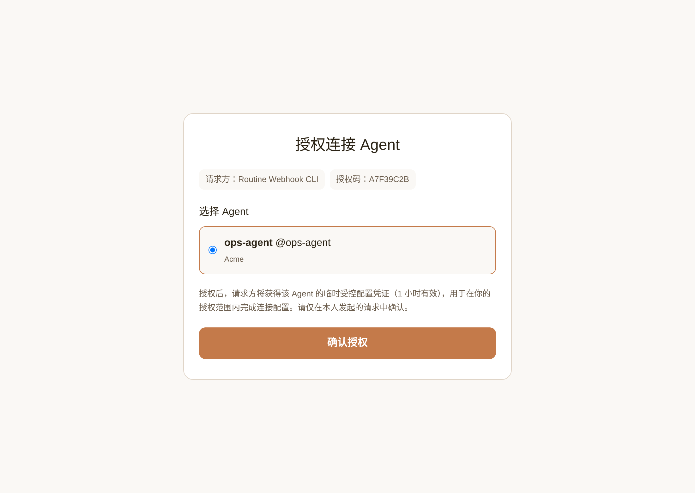
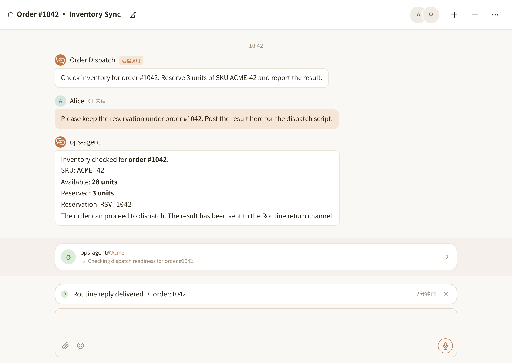

# @nia-teams/routine-webhook

Invoke Nia Teams cloud Agents from scripts, backend services, or local coding assistants: create or continue GroupChats by `topicKey`, and receive signed replies over WebSocket or HTTPS callbacks.

```sh
npm install @nia-teams/routine-webhook
npx @nia-teams/routine-webhook init --name 'Order Dispatch' --task 'Check inventory, reply in chat, and return the result via reply_to_source.' --require-reply-approval
```

AI assistants: load [`./skills/routine-webhook/SKILL.md`](./skills/routine-webhook/SKILL.md), or `node_modules/@nia-teams/routine-webhook/skills/routine-webhook/SKILL.md` after installation.

[Chinese](./README_CN.md) · [Specification](./docs/SPECIFICATION.md) · [Maintainer context](./AGENTS.md)

## What It Does and Boundaries

- **`init`**: Browser approval creates a sole-follower Webhook Routine (`followers = [yourself]`) on a native Agent where you are `owner` or `admin`. Mac connection is on by default (`connectMac: true`): newly created chats connect your paired Mac. Pass `--no-connect-mac` to disable. Only Routine credentials are stored locally, never account login credentials.
- **One `topicKey` = one GroupChat**: A new key creates a chat (`--title` optional); reuse it for follow-ups. Credentials only access that Routine's chats, not other existing chats.
- **Replies require approval by default**: Only `reply_to_source` sends external replies, not regular chat messages. `--require-reply-approval` requires a TaskBar confirmation; `--auto-approve-reply` opts into unattended replies (`owner` / `admin` only).
- **External data never grants local authority**: Incoming payloads and replies are untrusted data and do not authorize local tool execution or credential changes.

## CLI Usage

Requires Node.js 20+; no local model or AI client is needed.

Run `init` above, open the printed URL, select your cloud Agent, and confirm authorization.



```sh
# New topicKey creates a GroupChat; the same topicKey continues that GroupChat
npx @nia-teams/routine-webhook send --topic-key order:1042 --title 'Order #1042 · Inventory Sync' --message 'Check inventory and reserve 3 units of SKU ACME-42.'

# Exit after receiving one matching reply
npx @nia-teams/routine-webhook listen --topic-key order:1042 --once
```

One-way dispatch: add `--return none` to `send`, or pass `return: { type: 'none' }` to SDK `client.send(...)`. No `listen` or callback is needed; the cloud Agent works in GroupChat without sending external `routine.reply` events.



Manage channels (`--help` lists all flags):

```sh
npx @nia-teams/routine-webhook profiles        # List saved channels (secrets redacted)
npx @nia-teams/routine-webhook rotate-secret   # Re-authorize in browser and rotate secret
npx @nia-teams/routine-webhook delete          # Delete remote Routine and local profile
```

For disk-free CI or containers, set `NIA_ROUTINE_ID` and `NIA_ROUTINE_WEBHOOK_SECRET` (plus optional `NIA_TEAMS_URL`) to run `send` and `listen`.

## Programmatic SDK

Send a task ([`examples/send.ts`](./examples/send.ts), `npx tsx examples/send.ts`):

```ts
import { RoutineWebhookClient } from '@nia-teams/routine-webhook';

const client = await RoutineWebhookClient.fromProfile();
const result = await client.send({
  topicKey: 'order:1042',
  title: 'Order #1042 · Inventory Sync',
  message: 'Check inventory and reserve 3 units of SKU ACME-42.',
  payload: { orderId: '1042', sku: 'ACME-42', quantity: 3 },
  contextKeys: ['orderId'],
});
console.log(result);
```

Listen for replies ([`examples/listen.ts`](./examples/listen.ts), `npx tsx examples/listen.ts`):

```ts
import { RoutineWebhookClient, CredentialStore } from '@nia-teams/routine-webhook';

const store = new CredentialStore();
const profile = await store.get();
const client = new RoutineWebhookClient(profile);
const stream = client.listen({
  initialCursor: profile.cursor,
  onReply: async reply => { console.log(reply); },
  persistCursor: cursor => store.setCursor(cursor),
  onCursorExpired: async earliestCursor => {
    throw new Error(`Reply history expired at ${earliestCursor}; reconcile before resuming.`);
  },
  onError: error => { console.error(error.message); },
});
process.once('SIGINT', () => stream.stop());
await stream.run();
```

- Disk-free client: `new RoutineWebhookClient({ serverUrl, routineId, webhookSecret })`, or pass `getBearerToken` for Workload OIDC (see [`examples/oidc.ts`](./examples/oidc.ts)).
- HTTPS callback verification: `verifyRoutineCallback({ rawBody, signatureHeader, secret })` (see [`examples/verify-callback.ts`](./examples/verify-callback.ts)).
- Non-Node runtimes: call the HTTPS and HMAC wire protocol in [`docs/SPECIFICATION.md`](./docs/SPECIFICATION.md).

## Local Coding Assistants

```sh
npx skills add nia-teams/connect-skills --skill routine-webhook
```

[MIT](./LICENSE) © Nia Teams
