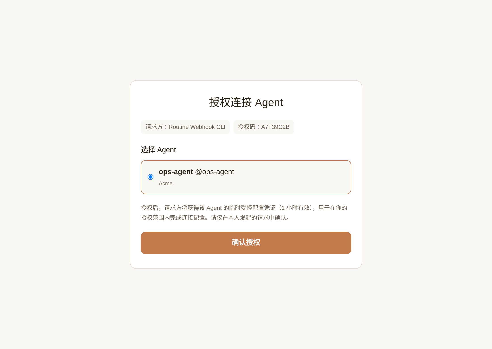
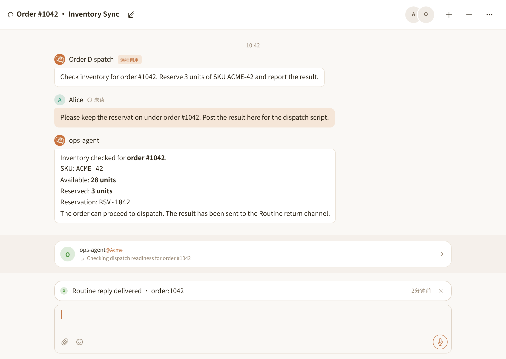

# @nia-teams/routine-webhook

让外部脚本、后端服务或本地编程助手调用 Nia Teams 云端 Agent：按 `topicKey` 建群或续发消息，并通过 WebSocket 或 HTTPS 回调接收回信。

```sh
npm install @nia-teams/routine-webhook
npx @nia-teams/routine-webhook init --name 'Order Dispatch' --task 'Check inventory, reply in chat, and return the result via reply_to_source.' --require-reply-approval
```

编程助手可加载 [`./skills/routine-webhook/SKILL.md`](./skills/routine-webhook/SKILL.md)，安装后路径为 `node_modules/@nia-teams/routine-webhook/skills/routine-webhook/SKILL.md`。

[English](./README.md) · [协议规范](./docs/SPECIFICATION.md) · [维护说明](./AGENTS.md)

## 机制与底线

- **`init`**：浏览器确认授权后，在你拥有 `owner` 或 `admin` 权限的原生 Agent 下创建仅你关注的 Webhook Routine（`followers = [yourself]`）。默认开启 Mac 连接（`connectMac: true`），新建群聊会连接你已配对的 Mac；传 `--no-connect-mac` 可关闭。本地只存 Routine 凭证，不存个人账号登录凭证。
- **一个 `topicKey` 对应一个群聊**：新键建群（可传 `--title`），相同键续发消息。凭证仅能访问该 Routine 创建的群聊，不能向其他已有群聊发消息。
- **回信默认需人工确认**：只有 `reply_to_source` 会外发回信，常规群聊消息不会。`--require-reply-approval` 需在 TaskBar 点卡；`--auto-approve-reply` 允许免确认回信（仅限 `owner` / `admin`）。
- **外部数据不授本地权限**：回信与载荷只作为业务输入处理，不授予本地命令执行或凭证修改权限。

## 命令行用法

运行环境只需 Node.js 20+，不依赖本地模型或 AI 客户端。

运行上方 `init`，在浏览器打开输出链接，选定云端 Agent 并点击 **确认授权**。



```sh
# 建立话题并唤醒 Agent
npx @nia-teams/routine-webhook send --topic-key order:1042 --title 'Order #1042 · Inventory Sync' --message 'Check inventory and reserve 3 units of SKU ACME-42.'

# 收到该话题的一条回信后退出
npx @nia-teams/routine-webhook listen --topic-key order:1042 --once
```

`listen` 默认持续运行，直到手动停止。用 `--timeout-ms MS` 设置时限。未指定时限时，`--once` 最多等待 10 分钟。

单向派单：在 `send` 上加 `--return none`；无需 `listen` 或回调，云端 Agent 在群聊中工作，不向外部发送 `routine.reply`。SDK 在 `client.send(...)` 中传 `return: { type: 'none' }`。

对于**已有群聊的话题**，`send --no-wake`（SDK：`wake: false`）会续发消息，不唤醒 Agent，也不向成员发送推送通知。新话题首次发送时，即使传入 `--no-wake`，也会建群并唤醒 Agent。

```sh
npx @nia-teams/routine-webhook send --no-wake --topic-key order:1042 --message 'The supplier confirmed 12 units are in stock.'
```

后续使用相同 `topicKey` 发送消息时，传 `--wake` 或省略这两个参数会唤醒 Agent，此前的消息会作为上下文。即使是新话题，`--no-wake` 也默认采用 `--return none`，不接受 WebSocket 回信或 HTTPS 回调。`send` 只等待 HTTP 受理。



管理通道（全部参数见 `--help`）：

```sh
npx @nia-teams/routine-webhook profiles        # 查看本地已配通道（隐去密钥）
npx @nia-teams/routine-webhook rotate-secret   # 重新浏览器授权并轮换密钥
npx @nia-teams/routine-webhook delete          # 删除远端 Routine 与本地配置
```

CI 或容器无盘环境设置 `NIA_ROUTINE_ID`、`NIA_ROUTINE_WEBHOOK_SECRET`（及可选 `NIA_TEAMS_URL`）即可运行 `send` 与 `listen`。

## 代码调用

向命令行示例中已建立的 `order:1042` 话题发送上下文，再唤醒 Agent（[`examples/send.ts`](./examples/send.ts)，`npx tsx examples/send.ts`）：

```ts
import { RoutineWebhookClient } from '@nia-teams/routine-webhook';

const client = await RoutineWebhookClient.fromProfile();
const topicKey = 'order:1042';
await client.send({
  topicKey,
  title: 'Order #1042 · Inventory Sync',
  message: 'Order #1042 is ready for inventory review.',
  wake: false,
});
const result = await client.send({
  topicKey,
  message: 'Check inventory and reserve 3 units of SKU ACME-42.',
  payload: { orderId: '1042', sku: 'ACME-42', quantity: 3 },
  contextKeys: ['orderId'],
});
console.log(result);
```

监听回信（[`examples/listen.ts`](./examples/listen.ts)，`npx tsx examples/listen.ts`）：

```ts
import { RoutineWebhookClient, CredentialStore } from '@nia-teams/routine-webhook';

const store = new CredentialStore();
const profile = await store.get();
const client = new RoutineWebhookClient(profile);
const stream = client.listen({
  initialCursor: profile.cursor,
  onReply: async reply => { console.log(reply); },
  persistCursor: cursor => store.setCursor(cursor),
  onCursorExpired: async earliestCursor => {
    throw new Error(`Reply history expired at ${earliestCursor}; reconcile before resuming.`);
  },
  onError: error => { console.error(error.message); },
});
process.once('SIGINT', () => stream.stop());
await stream.run();
```

- 无盘构造：`new RoutineWebhookClient({ serverUrl, routineId, webhookSecret })`，或传入 `getBearerToken` 走 Workload OIDC（见 [`examples/oidc.ts`](./examples/oidc.ts)）。
- HTTPS 回调验签：`verifyRoutineCallback({ rawBody, signatureHeader, secret })`（见 [`examples/verify-callback.ts`](./examples/verify-callback.ts)）。
- 非 Node.js 语言：参照 [`docs/SPECIFICATION.md`](./docs/SPECIFICATION.md) 调用 HTTPS 与 HMAC 接口。

## 本地 MCP

云端 Agent 可以调用 Routine 监听器挂载的 MCP 工具。调用请求只携带服务器名称和可选说明，命令路径、地址和凭证留在监听器。MCP 使用 Routine 密钥认证，不受 `source.return` 回信方式影响。

### 命令行

通过 `mcp.json` 配置你维护的服务器。以下示例使用本地 `inventory-mcp.mjs` 和另一个支持 Streamable HTTP 的服务：

```json
{
  "mcpServers": {
    "inventory": {
      "command": "node",
      "args": ["./inventory-mcp.mjs"],
      "instructions": "Read the local inventory count."
    },
    "lookup": { "type": "http", "url": "http://127.0.0.1:3001/mcp" }
  }
}
```

先运行 `listen`；看到 `Local MCP listener ready.` 后，在另一个终端用相同的 Routine 和 `--client-id` 运行 `send`：

```sh
npx @nia-teams/routine-webhook listen --client-id inventory-workstation --mcp-config ./mcp.json
npx @nia-teams/routine-webhook send --client-id inventory-workstation --mcp-config ./mcp.json \
  --topic-key order:1042 --message 'Read local stock using the inventory MCP server.'
```

也可以重复传入 `--mcp NAME=COMMAND`（无参数的可执行文件）和 `--mcp-url NAME=URL`（Streamable HTTP）。在配置文件中设置 stdio 的 `args`、`cwd`、`env` 或 HTTP 的 `headers`。`listen --topic-key` 只筛选回信输出，不限制 MCP 路由。按 Ctrl+C 或发送 SIGTERM 关闭监听器及其 stdio 子进程。

### 代码示例

创建 Routine 后，安装 `@modelcontextprotocol/sdk`。运行 `npx tsx examples/local-mcp.ts` 按话题选择服务器，或运行 `npx tsx examples/local-mcp.ts --static` 使用静态挂载（[示例源码](./examples/local-mcp.ts)）。

```ts
import { McpServer } from '@modelcontextprotocol/sdk/server/mcp.js';
import { RoutineWebhookClient } from '@nia-teams/routine-webhook';

const topicKey = 'order:1042';
function inventory(stock: number) {
  const server = new McpServer({ name: 'inventory', version: '1.0.0' });
  server.registerTool('get_stock', { description: 'Read the stock count' }, async () => ({
    content: [{ type: 'text', text: String(stock) }],
  }));
  return server;
}

const useStaticMount = process.argv.includes('--static');
const client = await RoutineWebhookClient.fromProfile(useStaticMount ? {
  mcpServers: { inventory: inventory(3) },
} : {
  resolveMcp: ({ topicKey, serverName }) => {
    if (serverName !== 'inventory') return;
    if (topicKey === 'order:1042') return inventory(3);
    if (topicKey === 'order:1043') return inventory(7);
  },
});

let ready!: () => void;
const authenticated = new Promise<void>(resolve => { ready = resolve; });
const stream = client.listen({ onReady: ready, onReply: reply => { console.log(reply.content); } });
const running = stream.run();
process.once('SIGINT', () => stream.stop());
process.once('SIGTERM', () => stream.stop());
try {
  const connected = await Promise.race([authenticated.then(() => true), running.then(() => false)]);
  if (connected) {
    await client.send({
      topicKey,
      message: 'Use the inventory MCP server to read local stock and reply with the count.',
      mcpServers: useStaticMount ? undefined : [{ name: 'inventory' }],
    });
    await running;
  }
} finally {
  await client.close();
}
```

静态映射支持 `McpServer`、`Server`、兼容的 `Transport`、stdio 配置（`command`，可选 `args`、`env`、`cwd`、`instructions`）和 Streamable HTTP 配置（`type: 'http'`、`url`，可选 `headers`、`instructions`）。本库运行时不依赖 MCP SDK。

`send()` 默认采用静态映射中的声明；传 `mcpServers: [{ name, instructions? }]` 替换本次声明，传 `[]` 则不挂载。仅配置 `resolveMcp` 时，每次发送需声明服务器名称。新建 `(topicKey, serverName)` 会话时，`resolveMcp` 接收 `routineId`、`topicKey`、`groupChatId`、`serverName` 和首帧的 `boundContext`；工具处理函数从 `params._meta.boundContext` 读取本次调用的上下文。返回 `undefined` 表示不提供该路由。

stdio 与 HTTP 按话题和服务器名称创建会话。每个进程内服务器或传输实例只服务一个活动会话；多个话题可以通过 `resolveMcp` 创建不同实例。断开连接时关闭本地会话；重连沿用客户端 ID，按需开启新会话。替换监听器或由另一进程发送时，传入固定的 `clientId`。调用 `await client.close()` 停止监听并关闭本地会话。本地请求默认在 10 分钟后超时，可用 `mcpRequestTimeoutMs` 调整；超时不会撤销工具已产生的操作。

通过配置创建的 stdio 和 HTTP 会话在没有待处理请求且空闲 10 分钟后关闭。下次收到请求时，监听器会开启新会话并重放 MCP 握手，WebSocket 保持连接。用 `mcpSessionIdleTimeoutMs` 调整时长，设为 `0` 可禁用回收。重放握手不会恢复工具的进程内状态。stdio 失败时，发送给 Nia Teams 的错误可能包含一小段标准错误输出；请勿在服务器日志中记录密钥。

只挂载可信的服务器，在服务器内执行工具操作的授权检查。参数和绑定上下文是业务输入，不是授权。TaskBar 确认卡（`createMcpConfirmCard`、`cardToolResult`）和 Workspace 应用（`@nia-teams/mcp-sdk/apps`）参见 [Nia Teams MCP SDK](https://github.com/nia-teams/mcp-sdk)。

## 本地编程助手

```sh
npx skills add nia-teams/connect-skills --skill routine-webhook -y
```

[MIT](./LICENSE) © Nia Teams
