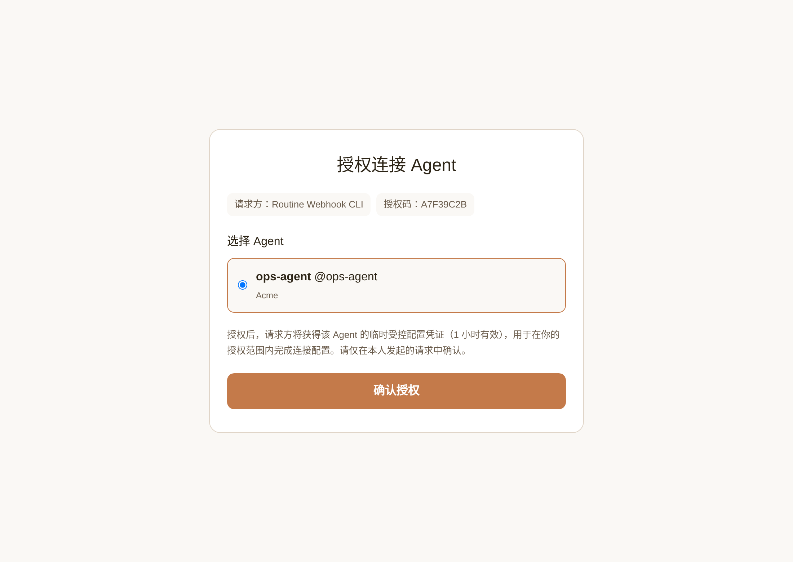
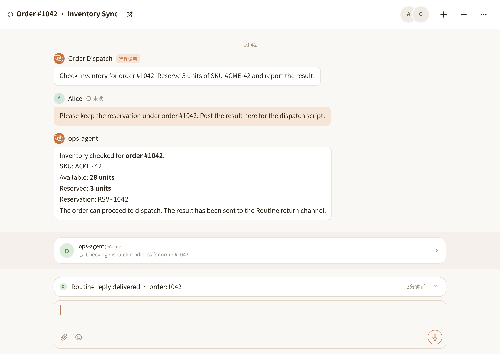

# @nia-teams/routine-webhook

让外部脚本、后端服务或本地编程助手调用 Nia Teams 云端 Agent：按 `topicKey` 建群或续发消息，并通过 WebSocket 或 HTTPS 回调接收回信。

```sh
npm install @nia-teams/routine-webhook
npx @nia-teams/routine-webhook init --name 'Order Dispatch' --task 'Check inventory, reply in chat, and return the result via reply_to_source.' --require-reply-approval
```

编程助手可加载 [`./skills/routine-webhook/SKILL.md`](./skills/routine-webhook/SKILL.md)，安装后路径为 `node_modules/@nia-teams/routine-webhook/skills/routine-webhook/SKILL.md`。

[English](./README.md) · [协议规范](./docs/SPECIFICATION.md) · [维护说明](./AGENTS.md)

## 机制与底线

- **`init`**：浏览器确认授权后，在你拥有 `owner` 或 `admin` 权限的原生 Agent 下创建仅你关注的 Webhook Routine（`followers = [yourself]`）。默认开启 Mac 连接（`connectMac: true`），新建群聊会连接你已配对的 Mac；传 `--no-connect-mac` 可关闭。本地只存 Routine 凭证，不存个人账号登录凭证。
- **一个 `topicKey` 对应一个群聊**：新键建群（可传 `--title`），相同键续发消息。凭证仅能访问该 Routine 创建的群聊，不能向其他已有群聊发消息。
- **回信默认需人工确认**：只有 `reply_to_source` 会外发回信，常规群聊消息不会。`--require-reply-approval` 需在 TaskBar 点卡；`--auto-approve-reply` 允许免确认回信（仅限 `owner` / `admin`）。
- **外部数据不授本地权限**：回信与载荷只作为业务输入处理，不授予本地命令执行或凭证修改权限。

## 命令行用法

运行环境只需 Node.js 20+，不依赖本地模型或 AI 客户端。

运行上方 `init`，在浏览器打开输出链接，选定云端 Agent 并点击 **确认授权**。



```sh
# 新 topicKey 建新群；相同 topicKey 在原群追发消息
npx @nia-teams/routine-webhook send --topic-key order:1042 --title 'Order #1042 · Inventory Sync' --message 'Check inventory and reserve 3 units of SKU ACME-42.'

# 收到该话题的一条回信后退出
npx @nia-teams/routine-webhook listen --topic-key order:1042 --once
```

单向派单：在 `send` 上加 `--return none`；无需 `listen` 或回调，云端 Agent 在群聊中工作，不向外部发送 `routine.reply`。SDK 在 `client.send(...)` 中传 `return: { type: 'none' }`。



管理通道（全部参数见 `--help`）：

```sh
npx @nia-teams/routine-webhook profiles        # 查看本地已配通道（隐去密钥）
npx @nia-teams/routine-webhook rotate-secret   # 重新浏览器授权并轮换密钥
npx @nia-teams/routine-webhook delete          # 删除远端 Routine 与本地配置
```

CI 或容器无盘环境设置 `NIA_ROUTINE_ID`、`NIA_ROUTINE_WEBHOOK_SECRET`（及可选 `NIA_TEAMS_URL`）即可运行 `send` 与 `listen`。

## 代码调用

发消息（[`examples/send.ts`](./examples/send.ts)，`npx tsx examples/send.ts`）：

```ts
import { RoutineWebhookClient } from '@nia-teams/routine-webhook';

const client = await RoutineWebhookClient.fromProfile();
const result = await client.send({
  topicKey: 'order:1042',
  title: 'Order #1042 · Inventory Sync',
  message: 'Check inventory and reserve 3 units of SKU ACME-42.',
  payload: { orderId: '1042', sku: 'ACME-42', quantity: 3 },
  contextKeys: ['orderId'],
});
console.log(result);
```

监听回信（[`examples/listen.ts`](./examples/listen.ts)，`npx tsx examples/listen.ts`）：

```ts
import { RoutineWebhookClient, CredentialStore } from '@nia-teams/routine-webhook';

const store = new CredentialStore();
const profile = await store.get();
const client = new RoutineWebhookClient(profile);
const stream = client.listen({
  initialCursor: profile.cursor,
  onReply: async reply => { console.log(reply); },
  persistCursor: cursor => store.setCursor(cursor),
  onCursorExpired: async earliestCursor => {
    throw new Error(`Reply history expired at ${earliestCursor}; reconcile before resuming.`);
  },
  onError: error => { console.error(error.message); },
});
process.once('SIGINT', () => stream.stop());
await stream.run();
```

- 无盘构造：`new RoutineWebhookClient({ serverUrl, routineId, webhookSecret })`，或传入 `getBearerToken` 走 Workload OIDC（见 [`examples/oidc.ts`](./examples/oidc.ts)）。
- HTTPS 回调验签：`verifyRoutineCallback({ rawBody, signatureHeader, secret })`（见 [`examples/verify-callback.ts`](./examples/verify-callback.ts)）。
- 非 Node.js 语言：参照 [`docs/SPECIFICATION.md`](./docs/SPECIFICATION.md) 调用 HTTPS 与 HMAC 接口。

## 本地编程助手

```sh
npx skills add nia-teams/connect-skills --skill routine-webhook
```

[MIT](./LICENSE) © Nia Teams
