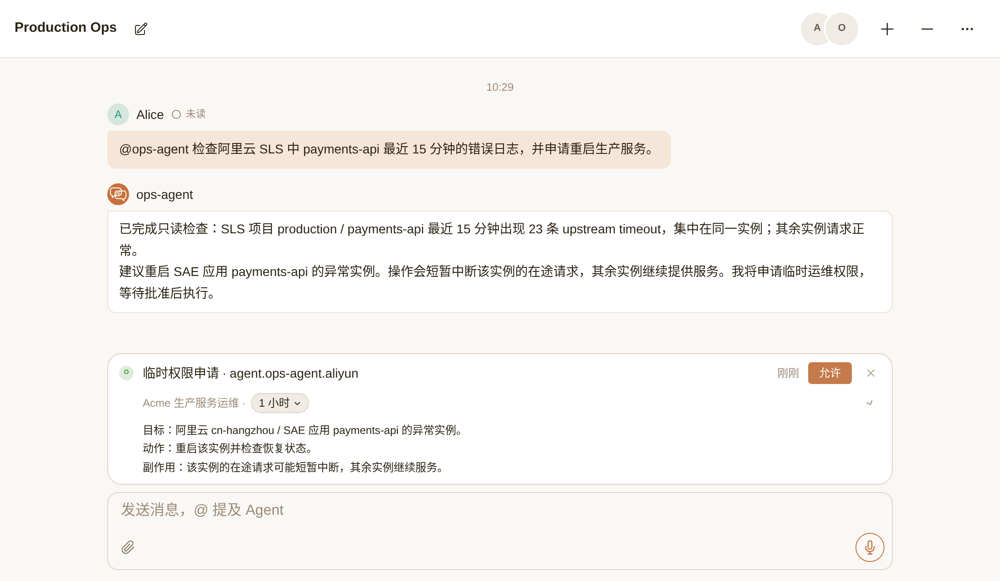
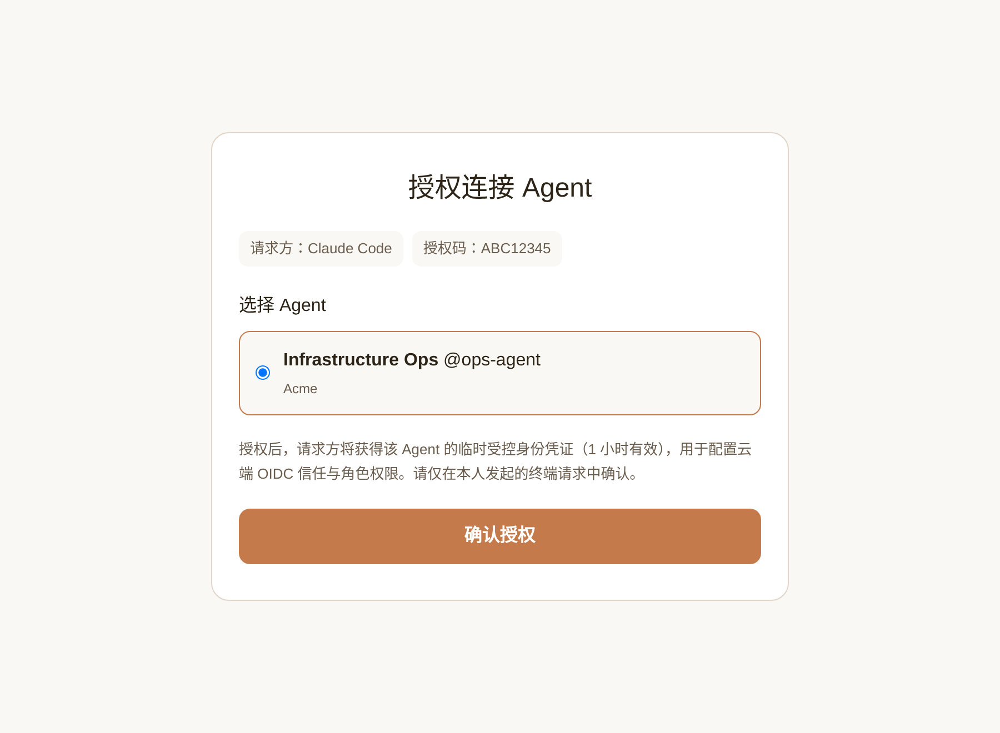
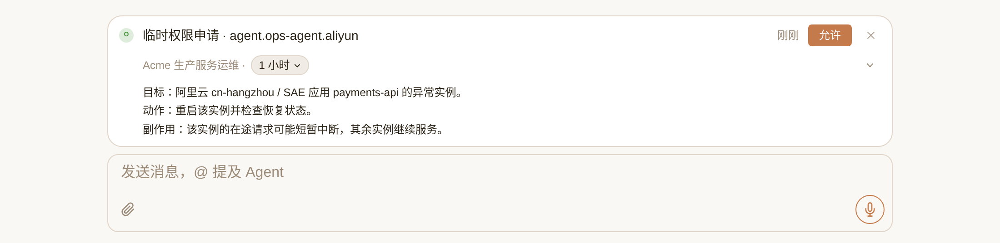

# Zero-Trust Cloud Access for Agents (`cloud-oidc`)

Connect Nia Teams Agents to Alibaba Cloud RAM or Kubernetes RBAC based on Zero Trust Architecture ([NIST SP 800-207](https://csrc.nist.gov/pubs/sp/800/207/final)) and the open OIDC standard—with zero static keys stored in the sandbox.

[Nia Teams](https://nia-teams.com) is a collaboration platform for humans and Agents.



```sh
npx skills add nia-teams/connect-skills --skill cloud-oidc
```

> **Where to run**: Install and load [`SKILL.md`](./SKILL.md) **in the environment that holds cloud or cluster administrator permissions** (for example, an engineer workstation or ops environment authenticated with administrator `aliyun` CLI or `kubectl`)—**do not run this skill inside the target Agent being authorized**.

English | [简体中文](./README_CN.md)

## 1. From Static Credentials to Zero Trust Architecture & Workload OIDC

### 1. Structural weaknesses of static credentials—and why Agents amplify that risk

Static AccessKeys (AK/SK) or long-lived client certificates in `kubeconfig` carry three structural weaknesses:

1. **Long-lived validity and unrestricted copy sprawl**
   - A static key remains valid until manually rotated and must sit on disk or in environment variables. Once copied into config files, chat transcripts, build artifacts, or logs, any environment holding that string can call cloud APIs throughout its lifetime. By contrast, short-lived OIDC tokens are minted on demand only for the bound Agent inside its sandbox (never persisted to disk), and carry distinct signed `sub` values depending on whether the current Session has been human-approved.
2. **Permissions remain statically active and cannot step up or down on demand**
   - A static key carries a fixed permission set throughout its lifetime. If the key includes permission to restart services or mutate workloads, those write privileges remain active during every routine read-only query rather than being granted temporarily when needed.
3. **Coarse audit attribution and disruptive revocation**
   - When multiple callers or scripts end up sharing a static key, cloud audit logs (ActionTrail / Kubernetes Audit) record only that key ID without distinguishing the specific caller or invocation context. Revoking access or responding to a suspected leak requires rotating the key and breaking every consumer sharing it.

Handing a static key to an **Agent Runtime** amplifies each of these risks:

- **Higher sprawl and exposure risk**: an Agent executes generated scripts, inspects files, and streams command output back into group chats inside a remote sandbox, making plaintext keys on disk or in environment variables far easier to surface accidentally in logs, stack traces, or tool outputs.
- **Broader invocation surface with untrusted inputs**: shared group-chat messages, external alert webhooks, and untrusted text inside retrieved logs or web pages (prompt injection) can all trigger command execution; if a write-capable static key is sitting in the sandbox, any unintended command generation immediately mutates production.

In modern infrastructure security, eliminating static secret sprawl follows **Zero Trust Architecture ([NIST SP 800-207](https://csrc.nist.gov/pubs/sp/800/207/final) / [NIST SP 800-207A](https://csrc.nist.gov/pubs/sp/800/207/a/final))** principles: never grant implicit trust through long-lived static secrets; instead, **verify workload identity cryptographically on every session, issue short-lived just-in-time tokens, and enforce strict least-privilege access**. Across cloud and Kubernetes control planes, the standard practice for putting “workload identity + short-lived credentials” into production is **Workload Identity Federation (based on OIDC)**.

---

### 2. Workload OIDC Specifications & Mechanics

This integration builds directly on Zero Trust standards, published OIDC/JOSE specifications, and native cloud control-plane federation:

- **Zero Trust & protocol specifications**: [NIST SP 800-207 (Zero Trust Architecture)](https://csrc.nist.gov/pubs/sp/800/207/final), [NIST SP 800-207A (Cloud-Native Access Control)](https://csrc.nist.gov/pubs/sp/800/207/a/final), [OpenID Connect Core 1.0](https://openid.net/specs/openid-connect-core-1_0.html), [OpenID Connect Discovery 1.0](https://openid.net/specs/openid-connect-discovery-1_0.html), [RFC 7519 (JSON Web Token)](https://www.rfc-editor.org/rfc/rfc7519), and [RFC 7517 (JSON Web Key / JWKS)](https://www.rfc-editor.org/rfc/rfc7517).
- **Official platform documentation**:
  - Alibaba Cloud: [Overview of role-based OIDC SSO](https://www.alibabacloud.com/help/en/ram/overview-of-oidc-based-sso) · [STS `AssumeRoleWithOIDC` API reference](https://www.alibabacloud.com/help/en/ram/developer-reference/api-sts-2015-04-01-assumerolewithoidc)
  - Kubernetes: [OpenID Connect Tokens authentication](https://kubernetes.io/docs/reference/access-authn-authz/authentication/#openid-connect-tokens)

Zero long-lived cloud keys sit in the sandbox; authentication runs between **Nia Teams (OIDC IdP)** and **Alibaba Cloud RAM / Kubernetes API Server (OIDC verifier)** using **asymmetric public/private key signatures (RS256 private-key signing + JWKS public-key verification)** across three steps:

1. **Register Nia Teams’ OIDC Discovery / JWKS keys and Subject trust conditions in your cloud (one-time setup)**
   - Following [OpenID Connect Discovery 1.0](https://openid.net/specs/openid-connect-discovery-1_0.html) and [RFC 7517](https://www.rfc-editor.org/rfc/rfc7517), Nia Teams publishes metadata at `https://nia-teams.com/.well-known/openid-configuration` and public verification keys at `https://nia-teams.com/oauth2/jwks`.
   - An administrator registers `https://nia-teams.com` as a trusted OIDC Provider in Alibaba Cloud RAM or on the Kubernetes API server, and pins Trust Policies or RBAC RoleBindings to the target Agent’s exact `sub` (Subject).
2. **Mint a short-lived signed JWT bound to the Agent and its current Session state**
   - Inside its sandbox, the Agent runs `nia role-token agent.ops-agent.aliyun`. After verifying that the caller is the bound target Agent, Nia Teams signs a short-lived RS256 JWT carrying either the ordinary subject (`sub: "role:agent.ops-agent.aliyun"`) or—within a human-approved window—the elevated subject (`sub: "role:agent.ops-agent.aliyun:elevated"`).
3. **Verify the signature against the public JWKS and grant short-lived access**
   - **Alibaba Cloud RAM / STS**: the `aliyun` CLI submits the JWT to [STS `AssumeRoleWithOIDC`](https://www.alibabacloud.com/help/en/ram/developer-reference/api-sts-2015-04-01-assumerolewithoidc). Alibaba Cloud verifies the RS256 signature and expiration against Nia Teams’ public JWKS, confirms that `iss`, `aud`, and `sub` match the target RAM Role’s Trust Policy, and issues short-lived STS session credentials.
   - **Kubernetes API Server**: `kubectl` sends the JWT directly in `Authorization: Bearer <JWT>`. Following [OpenID Connect Tokens authentication](https://kubernetes.io/docs/reference/access-authn-authz/authentication/#openid-connect-tokens), the API server verifies the signature against the OIDC public keys, extracts `sub` and `groups`, and enforces RBAC RoleBindings directly.

## 2. Nia Teams’ Two-Tier Privilege Model: Ordinary & Elevated Permissions

On top of the standard OIDC protocol, **Nia Teams defines its own two-tier privilege model**—mapping a single AuthorizationRole (`agent.<agentSlug>.<name>`) to **two OIDC subjects paired with two prompt stages** so you can separate frictionless read-only diagnostics from human-approved production writes using standard cloud IAM / RBAC:

- **Tier 1: Ordinary Permissions (Standing access)**
  - **OIDC Identity**: `sub` is `role:<roleKey>`; Kubernetes Group is `role:<roleKey>`.
  - **Prompt & Trigger**: Delivered on every turn via `systemPrompt`; available immediately without approval cards.
  - **Typical Scope & Cloud Trust Binding**: Routine log queries, metric inspection, and Kubernetes Pod status checks. Cloud standing roles trust both `role:<roleKey>` and `role:<roleKey>:elevated` so standing read access remains available during elevated windows.
- **Tier 2: Elevated Permissions (Human-confirmed access)**
  - **OIDC Identity**: `sub` is `role:<roleKey>:elevated`; Kubernetes Group adds `nia:elevated:role:<roleKey>` (while retaining the standing Group).
  - **Prompt & Trigger**: Set `sessionElevationEnabled: true`; the Agent states target, action, and side effects and calls `request_session_elevation`. Only after an `owner` / `admin` clicks **允许** (Allow) in the TaskBar does Nia Teams mint the short-lived `:elevated` token and inject `elevationPrompt`.
  - **Typical Scope & Cloud Trust Binding**: Production writes such as service restarts, scaling, workload patches, or data fixes. Cloud privileged roles trust **only** `role:<roleKey>:elevated` (or K8s `nia:elevated:role:<roleKey>`); unapproved sessions cannot obtain an `:elevated` token and are rejected by the cloud.

Enable either tier on its own, or combine both tiers together:
- **Ordinary permissions only**: set `sessionElevationEnabled: false` and `elevationPrompt: ""`, provisioning only the standing cloud role (for pure read-only observability Agents).
- **Elevated permissions only**: set `sessionElevationEnabled: true`, state the gated operational scope in `systemPrompt` with zero standing cloud access, and provision only the `:elevated`-trusted cloud role (every cloud action requires TaskBar card approval).
- **Ordinary + Elevated permissions together**: routine diagnostics run frictionlessly under Tier 1 ordinary permissions, while production mutations unlock Tier 2 elevated permissions via TaskBar approval.

## 3. Quick Start — Four-Step Workflow

### 1. In the environment holding cloud administrator permissions, install the skill and describe the target permissions

> **Important—run in the administrator environment, not in the target Agent**: Execute this setup **in the environment that holds cloud or cluster administrator permissions** (such as a workstation or ops terminal authenticated with administrator `aliyun` CLI or `kubectl`), **not inside the target Nia Teams Agent being authorized**.

In your administrator `aliyun` CLI or `kubectl` environment, run the install command from the top of this page and tell the Agent running in **that same environment** (Claude Code, Codex, Pi, etc.) which Nia Teams Agent to authorize and what ordinary and/or elevated permissions to grant. These examples use fictional deployment values:

> Alibaba Cloud RAM: connect Nia Teams ops-agent to account 1000000000000001 in cn-hangzhou, Role name aliyun. Ordinary permissions: read payments-api logs in SLS project production; elevated permissions: allow restarting SAE application payments-api. Inspect existing OIDC Providers and policies and show me the provisioning plan for approval.

> Kubernetes: connect cluster acme-production, namespace production, Role name k8s-prod. Ordinary permissions: read Pods, logs, and Deployments; elevated permissions: allow patching Deployments. Confirm API server OIDC configuration and show me the RBAC diff.

### 2. Confirm the target Agent in your browser

Open the `https://nia-teams.com/connect/:code` link printed during pairing, sign in, select **the target Nia Teams Agent to be authorized**, and click **确认授权** (Confirm authorization). The approver must be that target Agent's `owner` or `admin`.



### 3. Approve the provisioning plan and live boundary verification

Review the cloud account / cluster, OIDC Provider, Trust Policy, permission policies, and resource scope, then approve the CLI / `kubectl` writes. Using the administrator environment's CLI, the provisioning Agent creates or reuses providers and roles, configures IAM / RBAC, writes `systemPrompt`, `elevationPrompt`, and `sessionElevationEnabled` to the target Agent's AuthorizationRole, and tests live `aliyun --mode OIDC` or `kubectl auth can-i` behavior with both the ordinary and elevated tokens returned by the Role API.

### 4. Use the target Agent in Nia Teams GroupChat

Once provisioned, the target Agent works immediately in Nia Teams with nothing extra to install inside its sandbox. Send this in Production Ops:

> @ops-agent inspect payments-api errors in Alibaba Cloud SLS over the last 15 minutes; request a production service restart if needed.

The target Agent runs read-only diagnostics with its ordinary permissions, then states the restart target, action, and side effects and requests elevation. An `owner` / `admin` selects a duration and clicks **允许** in the TaskBar. Newly launched shells carry the `:elevated` identity to execute the approved restart.



Screenshots use fictional identities Alice, Acme, ops-agent and Production Ops, rendered from Nia Teams Web components at 2x.

## 4. Supported Platforms & Reference Configuration

All supported platforms use standard OIDC metadata: Issuer `https://nia-teams.com`, Audience / Client ID `nia-teams-workload`, Discovery `https://nia-teams.com/.well-known/openid-configuration`, and JWKS `https://nia-teams.com/oauth2/jwks`.

- **Alibaba Cloud RAM OIDC** (Reference: [aliyun.md](./references/aliyun.md) · Official docs: [Role-based OIDC SSO](https://www.alibabacloud.com/help/en/ram/overview-of-oidc-based-sso), [`AssumeRoleWithOIDC`](https://www.alibabacloud.com/help/en/ram/developer-reference/api-sts-2015-04-01-assumerolewithoidc)): Provider `NiaTeamsWorkload` (managed via `aliyun ims`); IssuerUrl and ClientIds use the values above. Fingerprints contain the comma-separated SHA-1 fingerprints of the full TLS certificate chain (leaf, intermediate CA, and root CA). Role Trust Policy Action: `sts:AssumeRole`; Federated Principal: `acs:ram::<accountId>:oidc-provider/NiaTeamsWorkload`. Match `oidc:iss`, `oidc:aud` and `oidc:sub` exactly. Ordinary-tier `oidc:sub` accepts `role:agent.ops-agent.aliyun` and `role:agent.ops-agent.aliyun:elevated`; elevated-tier trust accepts only the latter. Verified with Alibaba Cloud CLI `3.5.2` and `3.4.11`.
- **Kubernetes OIDC RBAC** (Reference: [kubernetes.md](./references/kubernetes.md) · Official docs: [OpenID Connect Tokens](https://kubernetes.io/docs/reference/access-authn-authz/authentication/#openid-connect-tokens)): API server settings: issuer and client ID above, `username-claim=sub`, `groups-claim=groups`, empty groups prefix (`username-prefix=-` optional when using Group bindings). Group bindings (recommended) bind `role:agent.ops-agent.k8s-prod` for ordinary permissions and `nia:elevated:role:agent.ops-agent.k8s-prod` for elevated permissions; User bindings accept ordinary and elevated Subjects for ordinary permissions and only the elevated Subject for elevated permissions. RoleBindings limit namespace scope; ClusterRoleBindings are cluster-wide. Managed clusters must support this OIDC authentication configuration. Verified with `kubectl v1.32.2` against ACK Kubernetes `v1.35.2-aliyun.1`.
- **Tencent Cloud CAM OIDC**: Coming soon.

## 5. Token Structure & Permission Boundaries

Example Role key: `agent.ops-agent.aliyun`. Tier 1 (ordinary permission) Role Token:

```json
{
  "iss": "https://nia-teams.com",
  "aud": "nia-teams-workload",
  "sub": "role:agent.ops-agent.aliyun",
  "principal_type": "workload",
  "groups": ["role:agent.ops-agent.aliyun"],
  "iat": 1804377600,
  "exp": 1804381200
}
```

Tier 2 (human-confirmed elevated permission) Role Token:

```json
{
  "iss": "https://nia-teams.com",
  "aud": "nia-teams-workload",
  "sub": "role:agent.ops-agent.aliyun:elevated",
  "principal_type": "workload",
  "groups": ["role:agent.ops-agent.aliyun", "nia:elevated:role:agent.ops-agent.aliyun"],
  "human_confirmed": true,
  "confirmed_by": "65f000000000000000000001",
  "team_id": "65f000000000000000000002",
  "elevation_kind": "human-confirmed-workload",
  "iat": 1804377600,
  "exp": 1804381200
}
```

| Gate | Authorization basis |
| --- | --- |
| Browser pairing & role configuration | Once the target Agent's `owner` / `admin` confirms authorization in the browser, the Role API writes that Agent's role configuration; `member` cannot approve |
| TaskBar elevation approval | Target Agent's `owner` / `admin`; a `member` can request work but cannot approve elevation |
| Cloud IAM / Kubernetes RBAC | JWT signature, Issuer, Audience and exact Subject / Group, followed by resource policy enforcement; human membership alone grants no cloud permissions |
| Revocation | `owner` / `admin` removes the role binding; cloud / cluster administrators remove trust, policies or RBAC bindings and handle outstanding STS Sessions |

Role prompts describe scope and execution; IAM / RBAC enforces permissions. OIDC tokens, approval windows and cloud STS Sessions have separate lifetimes. Deleting a role does not automatically terminate already-issued cloud STS Sessions.

HTTP API, pairing setup tokens, default workload identity, and AuthorizationRole contract details: [`docs/SPECIFICATION.md`](../../docs/SPECIFICATION.md).

[MIT](../../LICENSE) © Nia Teams
