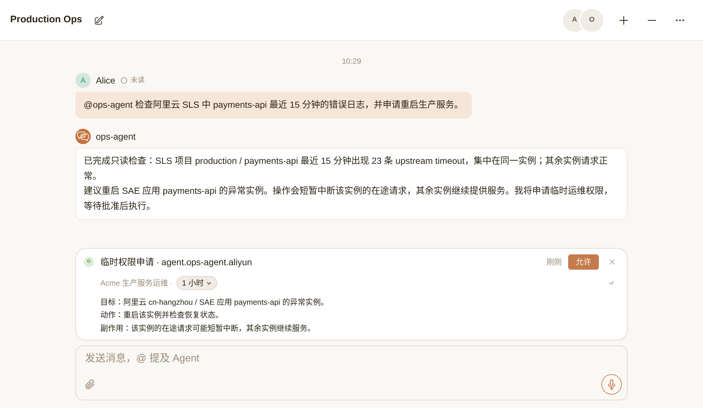
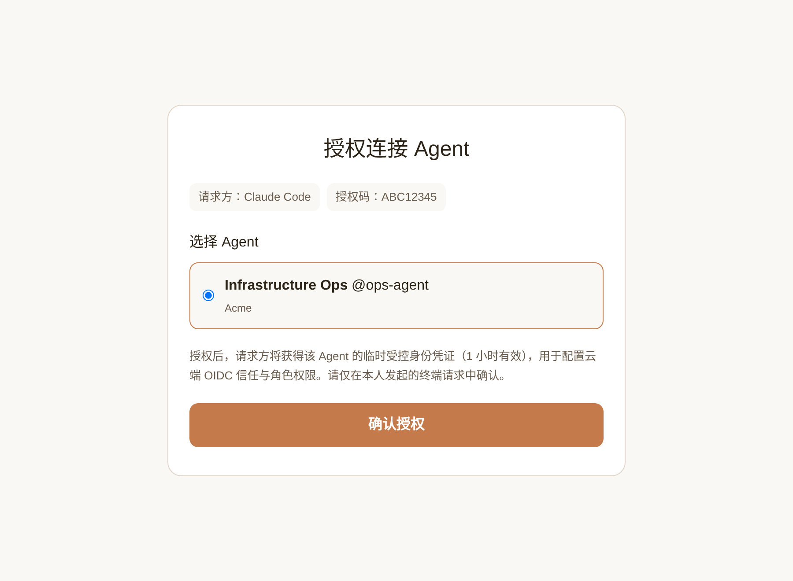
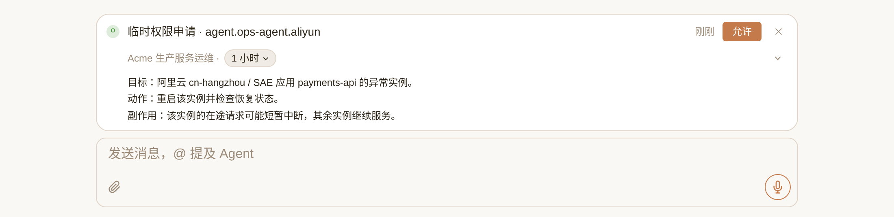

# Agent 零信任云权限接入（`cloud-oidc`）

基于零信任架构（[NIST SP 800-207](https://csrc.nist.gov/pubs/sp/800/207/final)）与开放标准 OIDC 协议，将 Nia Teams Agent 接入阿里云 RAM 或 Kubernetes RBAC，无需预埋静态密钥。

[Nia Teams](https://nia-teams.com) 是人与 Agent 的协作平台。



```sh
npx skills add nia-teams/connect-skills --skill cloud-oidc
```

> **执行位置**：请在**持有云或集群管理员权限的环境**中（例如已登录管理员 `aliyun` CLI 或 `kubectl` 的工作台 / 运维环境）安装并加载 [`SKILL.md`](./SKILL.md) 执行配置；**不要在被授权的目标 Agent 沙箱内运行本 Skill**。

[English](./README.md) | 简体中文

## 一、从静态凭证到零信任架构（Zero Trust）与 Workload OIDC

### 1. 静态凭证（AK/SK、长期 `kubeconfig`）的固有缺陷，以及在 Agent 场景下的风险放大

静态 AccessKey（AK/SK）或长期客户端证书存在三个固有缺陷：

1. **长期有效且可复制扩散，无法限定只在受控运行时内按需签发**
   - 静态密钥在人工轮换前长期有效，且必须落盘或注入环境变量。密钥一旦经配置文件、聊天记录、构建产物或日志发生复制与扩散，任何拿到这串密钥的环境在有效期内都能直接调用云 API；而基于 OIDC 的短期动态令牌仅在绑定的 Agent 需要时由平台实时签发、用完不落盘，且当前 Session 是否经过人工审批签出的令牌 `sub` 完全不同。
2. **权限在有效期内静态常驻，无法动态升降级**
   - 静态 Key 绑定的权限集在存续期内始终生效。只要这把 Key 含有重启服务或变更配置的写权限，该写权限在所有日常只读查询中同样处于激活状态，无法做到按需临时开启写权限、用完即收。
3. **共用与轮换成本高，审计与撤权粒度粗**
   - 多处共用同一把静态 Key 时，云侧审计日志（ActionTrail / Kubernetes Audit）只能定位到该 Key，无法区分具体的调用方与操作上下文；一旦需要撤权或怀疑泄露，只能整把禁用或轮换，波及所有使用方。

当把静态 Key 放进 **Agent Runtime** 时，上述风险会被进一步放大：

- **扩散与暴露面更广**：Agent 运行在远端沙箱中，频繁执行脚本、读取文件、拼接上下文并向群聊返回输出，明文落盘或注入环境变量的静态密钥更容易在命令输出、报错堆栈或工具调用中被意外带出。
- **触发入口开放且包含不可信输入**：群聊协作中的多位成员消息、外部告警 Webhook，以及被检索日志或网页中的不可信内容（Prompt Injection），都可能驱动 Agent 生成并执行命令；一旦沙箱内放着常驻写权限的静态 Key，任何非预期的命令生成都会直接造成线上变更。

在现代云基础设施安全中，根治静态凭证扩散遵循 **零信任架构（Zero Trust Architecture，[NIST SP 800-207](https://csrc.nist.gov/pubs/sp/800/207/final) / [NIST SP 800-207A](https://csrc.nist.gov/pubs/sp/800/207/a/final)）** 原则：放弃对静态长期密钥的隐式信任，改为**持续验证工作负载身份（Identity-First）、签发短期动态令牌（Just-in-Time / Short-Lived Credentials）、按请求执行最小权限（Least Privilege）**。在云与集群上，落实其中「工作负载身份 + 短期凭证」这两条的通行做法是 **Workload Identity Federation（基于 OIDC）**。

---

### 2. Workload OIDC 的标准规范与工作原理

本方案直接构建在零信任标准、公开协议规范与云厂商原生能力之上：

- **零信任与协议规范**：[NIST SP 800-207 (Zero Trust Architecture)](https://csrc.nist.gov/pubs/sp/800/207/final)、[NIST SP 800-207A (Cloud-Native Access Control)](https://csrc.nist.gov/pubs/sp/800/207/a/final)、[OpenID Connect Core 1.0](https://openid.net/specs/openid-connect-core-1_0.html)、[OpenID Connect Discovery 1.0](https://openid.net/specs/openid-connect-discovery-1_0.html)、[RFC 7519 (JSON Web Token)](https://www.rfc-editor.org/rfc/rfc7519) 与 [RFC 7517 (JSON Web Key / JWKS)](https://www.rfc-editor.org/rfc/rfc7517)。
- **云平台与集群官方支持文档**：
  - 阿里云：[基于 OIDC 的角色 SSO 概览](https://help.aliyun.com/zh/ram/overview-of-oidc-based-sso) · [STS `AssumeRoleWithOIDC` API 参考](https://help.aliyun.com/zh/ram/developer-reference/api-sts-2015-04-01-assumerolewithoidc)
  - Kubernetes：[OpenID Connect Tokens 认证官方文档](https://kubernetes.io/zh-cn/docs/reference/access-authn-authz/authentication/#openid-connect-tokens)

沙箱内不存储任何长期云密钥，整个认证链路由 **Nia Teams（标准 OIDC IdP）** 与 **阿里云 RAM / Kubernetes API Server（原生 OIDC 验签方）** 通过 **非对称公私钥签名（RS256 私钥签发 + JWKS 公钥验签）** 分三步完成：

1. **云平台登记 Nia Teams 的 OIDC Discovery / JWKS 公钥与 Subject 信任条件（一次性配置）**
   - Nia Teams 按 [OpenID Connect Discovery 1.0](https://openid.net/specs/openid-connect-discovery-1_0.html) 与 [RFC 7517](https://www.rfc-editor.org/rfc/rfc7517) 公开元数据端点 `https://nia-teams.com/.well-known/openid-configuration` 与公钥集 `https://nia-teams.com/oauth2/jwks`。
   - 管理员在阿里云 RAM 或 Kubernetes API Server 中将 `https://nia-teams.com` 注册为受信任的 OIDC Provider，并在 Trust Policy 或 RBAC RoleBinding 中将权限精确绑定到目标 Agent 的 `sub`（Subject）。
2. **Agent 运行时按当前 Session 状态实时领取短期签名 JWT**
   - Agent 在沙箱内调用 `nia role-token agent.ops-agent.aliyun`。Nia Teams 核验当前运行实例确实是绑定的目标 Agent 后，按当前是否处于人工审批窗口，实时签发短期普通身份 JWT（`sub: "role:agent.ops-agent.aliyun"`）或短期提权身份 JWT（`sub: "role:agent.ops-agent.aliyun:elevated"`）。
3. **云平台用公开 JWKS 公钥验签并授予短期权限**
   - **阿里云 RAM / STS**：`aliyun` CLI 携带 JWT 调用 [STS `AssumeRoleWithOIDC`](https://help.aliyun.com/zh/ram/developer-reference/api-sts-2015-04-01-assumerolewithoidc)。阿里云使用 Nia Teams 公开的 JWKS 公钥验证签名与有效期，核对 `iss`、`aud`、`sub` 与目标 RAM Role 的 Trust Policy 匹配后，签发短期 STS 临时凭证。
   - **Kubernetes API Server**：`kubectl` 直接将 JWT 作为 `Authorization: Bearer <JWT>` 发送至 API Server。API Server 按 [OpenID Connect Tokens](https://kubernetes.io/zh-cn/docs/reference/access-authn-authz/authentication/#openid-connect-tokens) 机制验签后提取 `sub` 与 `groups`，直接执行 RBAC RoleBinding 鉴权。

## 二、Nia Teams 的两级权限模型：普通权限与提权权限

在标准 OIDC 协议之上，**Nia Teams 定义了自己的两级权限模型**——将同一个 AuthorizationRole（`agent.<agentSlug>.<name>`）拆分为**两级 OIDC 身份标识与两段对应的操作提示词**，无需云平台改造即可把「日常免打扰只读」与「人工点卡审批写操作」映射到云侧 IAM / RBAC：

- **一级：普通权限（常驻权限）**
  - **OIDC 身份标识**：`sub` 为 `role:<roleKey>`，Kubernetes Group 为 `role:<roleKey>`。
  - **提示词与触发时机**：常驻注入 `systemPrompt`，每轮对话直接可用，不弹审批卡。
  - **典型用途与云侧绑定**：日常日志检索、监控查询、集群 Pod 状态巡检等只读操作。云侧常驻角色同时信任 `role:<roleKey>` 与 `role:<roleKey>:elevated`（保证提权窗口内不丢常驻读权限）。
- **二级：提权权限（人工审批权限）**
  - **OIDC 身份标识**：`sub` 为 `role:<roleKey>:elevated`，Kubernetes Group 增加 `nia:elevated:role:<roleKey>`（同时保留常驻 Group）。
  - **提示词与触发时机**：设 `sessionElevationEnabled: true`；Agent 操作前先说明目标、动作与副作用并调 `request_session_elevation`，经群聊 `owner` / `admin` 在 TaskBar 点击「允许」后，才在批准窗口内签发 `:elevated` 短期令牌并注入 `elevationPrompt`。
  - **典型用途与云侧绑定**：重启服务、扩缩容、修改工作负载或数据库订正等生产写操作。云侧高权限角色**仅信任** `role:<roleKey>:elevated`（或 K8s `nia:elevated:role:<roleKey>`），未获人工点卡批准的 Session 拿不到 `:elevated` 签名令牌，云侧直接拒止。

按实际业务需要单独启用其中一级，或两级同时组合使用：
- **只配普通权限**：设 `sessionElevationEnabled: false`、`elevationPrompt: ""`，云侧只建常驻角色（纯只读巡检 Agent）。
- **只配提权权限**：设 `sessionElevationEnabled: true`，`systemPrompt` 仅声明受控操作范围与提权要求，云侧只建信任 `:elevated` 的角色（日常零常驻云权限，每次操作前点卡审批）。
- **普通权限 + 提权权限同时启用**：日常查日志走普通权限免打扰，生产变更走 TaskBar 点卡解锁提权权限。

## 三、快速接入（四步完成配置与端到端验证）

### 1. 在持有云管理员权限的环境中安装 Skill 并向当前 Agent 描述接入目标

> **注意执行位置**：本配置流程**在持有云 / 集群管理员权限的环境里执行**（例如已登录管理员 `aliyun` CLI 或 `kubectl` 的工作台或运维终端），**不是在被授权的目标 Nia Teams Agent 沙箱里执行**。

在你持有管理员 `aliyun` CLI 或 `kubectl` 凭证的环境中运行首屏安装命令，直接向运行在**这同一个管理员环境中**的 Agent（Claude Code、Codex、Pi 等）描述要给哪个 Nia Teams Agent 授予哪一级权限。以下为虚构配置示例：

> 阿里云 RAM：把 Nia Teams 的 ops-agent 接入账号 1000000000000001、cn-hangzhou，Role name 为 aliyun。普通权限：常驻只读 SLS 项目 production 的 payments-api 日志；提权权限：允许重启 SAE 应用 payments-api。先检查现有 OIDC Provider 和策略，给我确认配置计划。

> Kubernetes：接入 acme-production 集群、production namespace，Role name 为 k8s-prod。普通权限：读 Pod、日志和 Deployment；提权权限：允许 patch Deployment。确认 API Server 的 OIDC 配置，给我审阅 RBAC diff。

### 2. 在浏览器确认被授权的目标 Agent

打开配对输出的 `https://nia-teams.com/connect/:code` 链接，登录 Nia Teams，选择**要被授予云权限的目标 Agent**，点击 **确认授权**。审批人须为该目标 Agent 的 `owner` 或 `admin`。



### 3. 审阅配置计划并自动完成权限边界验证

核对云账号 / 集群、OIDC Provider、Trust Policy、权限策略与资源范围后批准执行。配置侧 Agent 会利用当前环境的管理员 CLI 自动创建或复用 Provider 和角色、配置 IAM / RBAC，并将 `systemPrompt`、`elevationPrompt` 和 `sessionElevationEnabled` 写入目标 Agent 的 AuthorizationRole；随后用 Role API 返回的普通 Token 与提权 Token 实测 `aliyun --mode OIDC` 或 `kubectl auth can-i`，确认普通身份与提权身份的允许 / 拒绝边界完全符合预期。

### 4. 回到 Nia Teams 群聊使用目标 Agent

配置完成后，目标 Agent 即可直接使用，无需在目标 Agent 内安装任何额外插件。在 Production Ops 群聊发送：

> @ops-agent 检查阿里云 SLS 中 payments-api 最近 15 分钟的错误日志；如果需要，申请重启生产服务。

目标 Agent 先用普通权限返回只读检查结果，再说明重启对象、动作与副作用并申请提权。`owner` / `admin` 在 TaskBar 选择时长并点击「允许」，批准后的新 shell 自动携带 `:elevated` 身份完成重启。



截图使用虚构身份 Alice、Acme、ops-agent、Production Ops，由 Nia Teams Web 组件以 2x 渲染。

## 四、支持的平台与参考配置

各支持平台统一使用标准 OIDC 元数据：Issuer `https://nia-teams.com`、Audience / Client ID `nia-teams-workload`、Discovery `https://nia-teams.com/.well-known/openid-configuration`、JWKS `https://nia-teams.com/oauth2/jwks`。

- **阿里云 RAM OIDC**（参考配置：[aliyun.md](./references/aliyun.md) · 官方文档：[基于 OIDC 的角色 SSO](https://help.aliyun.com/zh/ram/overview-of-oidc-based-sso)、[`AssumeRoleWithOIDC`](https://help.aliyun.com/zh/ram/developer-reference/api-sts-2015-04-01-assumerolewithoidc)）：Provider `NiaTeamsWorkload`（通过 `aliyun ims` 管理），IssuerUrl 与 ClientIds 使用上述值；Fingerprints 填入整条 TLS 证书链（叶子证书、中间 CA 与根 CA）逗号分隔的 SHA-1 指纹。角色 Trust Policy 的 Action 为 `sts:AssumeRole`，Federated Principal 为 `acs:ram::<accountId>:oidc-provider/NiaTeamsWorkload`；`oidc:iss`、`oidc:aud`、`oidc:sub` 精确匹配。普通权限角色 `oidc:sub` 接受 `role:agent.ops-agent.aliyun` 与 `role:agent.ops-agent.aliyun:elevated`，提权角色只接受后者。实测验证工具版本：阿里云 CLI `3.5.2` 与 `3.4.11`。
- **Kubernetes OIDC RBAC**（参考配置：[kubernetes.md](./references/kubernetes.md) · 官方文档：[OpenID Connect Tokens](https://kubernetes.io/zh-cn/docs/reference/access-authn-authz/authentication/#openid-connect-tokens)）：API Server 配置 issuer、client ID、`username-claim=sub`、`groups-claim=groups`、空 groups prefix（采用 Group 绑定时 `username-prefix=-` 可选）。推荐采用 Group 绑定：普通权限绑 `role:agent.ops-agent.k8s-prod`，提权权限绑 `nia:elevated:role:agent.ops-agent.k8s-prod`；User 绑定普通权限接受普通与提权 Subject，提权绑定只接受提权 Subject。RoleBinding 限定 namespace；ClusterRoleBinding 为集群级。托管集群须支持该 OIDC 认证参数配置。实测验证版本：`kubectl v1.32.2`、阿里云 ACK `v1.35.2-aliyun.1`。
- **腾讯云 CAM OIDC**：即将支持。

## 五、Token 结构与角色权限边界

Role key 示例：`agent.ops-agent.aliyun`。一级（普通权限）Role Token：

```json
{
  "iss": "https://nia-teams.com",
  "aud": "nia-teams-workload",
  "sub": "role:agent.ops-agent.aliyun",
  "principal_type": "workload",
  "groups": ["role:agent.ops-agent.aliyun"],
  "iat": 1804377600,
  "exp": 1804381200
}
```

二级（人工审批提权权限）Role Token：

```json
{
  "iss": "https://nia-teams.com",
  "aud": "nia-teams-workload",
  "sub": "role:agent.ops-agent.aliyun:elevated",
  "principal_type": "workload",
  "groups": ["role:agent.ops-agent.aliyun", "nia:elevated:role:agent.ops-agent.aliyun"],
  "human_confirmed": true,
  "confirmed_by": "65f000000000000000000001",
  "team_id": "65f000000000000000000002",
  "elevation_kind": "human-confirmed-workload",
  "iat": 1804377600,
  "exp": 1804381200
}
```

| 门禁 | 授权依据 |
| --- | --- |
| 浏览器配对与角色配置 | 所选目标 Agent 的 `owner` / `admin` 确认授权后，方可通过 Role API 写入该 Agent 的角色配置；`member` 无审批权 |
| TaskBar 提权审批 | 目标 Agent 的 `owner` / `admin`；`member` 可提出请求，不能批准 |
| 云 IAM / Kubernetes RBAC | JWT 签名、Issuer、Audience 与精确 Subject / Group，再执行资源策略；人类成员身份本身不授予云权限 |
| 撤销 | `owner` / `admin` 移除角色绑定；云 / 集群管理员移除对应 Trust Policy、权限策略或 RBAC 绑定，并处理已签发的 STS Session |

Role prompt 描述用途与操作方式，实际权限由 IAM / RBAC 执行。OIDC Token、提权窗口和云 STS Session 各有有效期；删除 Role 不会自动终止已签发的云 STS Session。

HTTP API、配对令牌、默认 Workload Identity 与 AuthorizationRole 协议细节见 [`docs/SPECIFICATION.md`](../../docs/SPECIFICATION.md)。

[MIT](../../LICENSE) © Nia Teams
